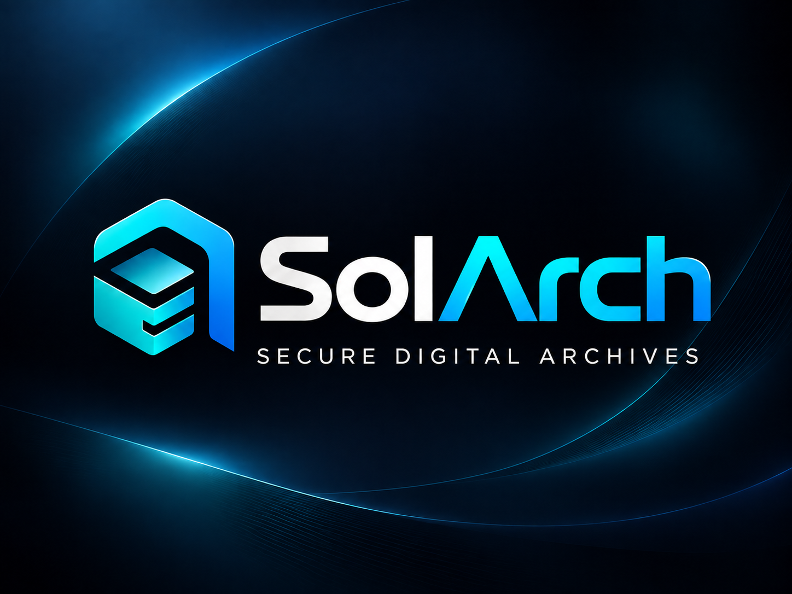
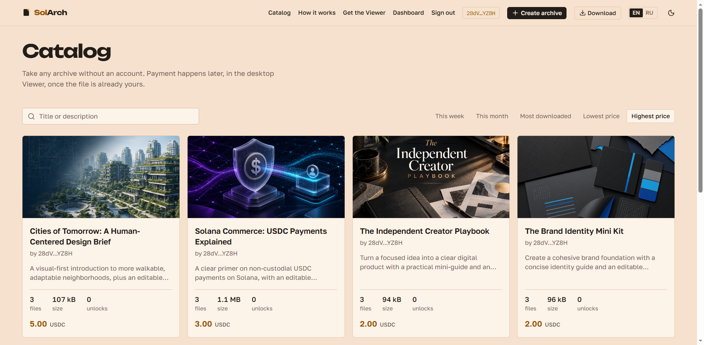
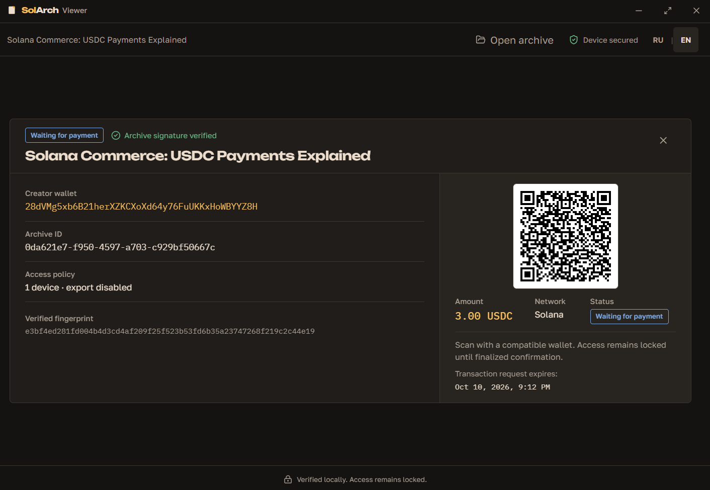
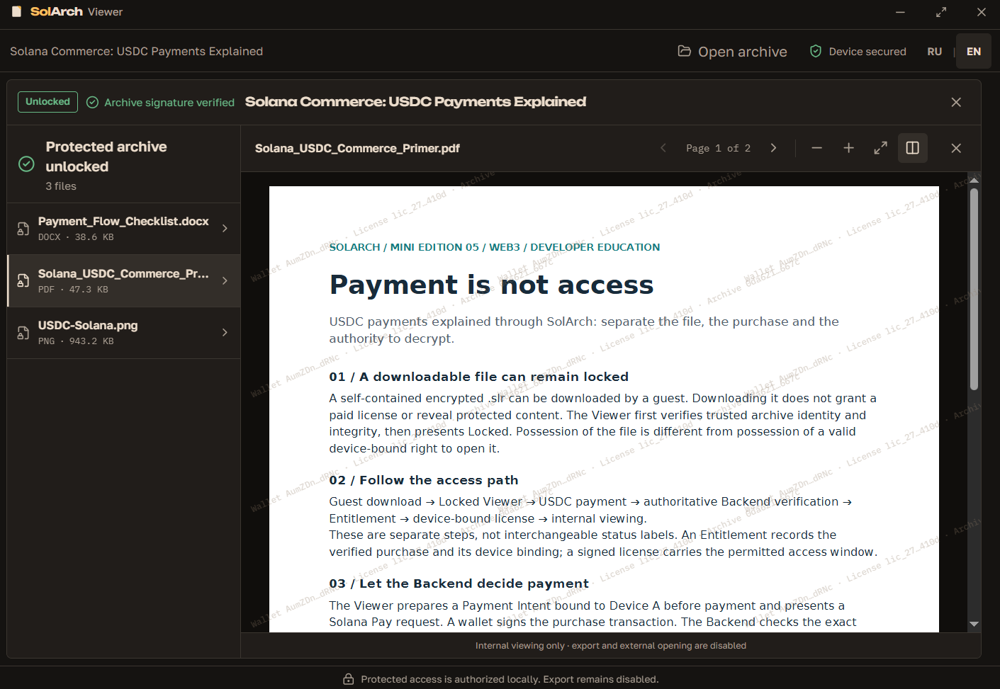

<p align="center">
  
</p>

<h1 align="center">SolArch</h1>
<p align="center"><strong>Copy the file. Not the access.</strong></p>
<p align="center">A marketplace for portable encrypted <code>.slr</code> archives, unlocked with verified USDC payments and device-bound licenses on Solana.</p>

<p align="center">
  <a href="https://github.com/kiratonine/SolArch/actions/workflows/ci-frontend.yml"></a>
  <a href="https://github.com/kiratonine/SolArch/actions/workflows/ci-backend.yml"></a>
  <a href="https://solana.com/"></a>
  
  
</p>

<p align="center">
  <a href="https://sol-arch.vercel.app/">🌐 Live App</a> ·
  <a href="https://sol-arch.vercel.app/download">💻 Get Viewer</a> ·
  <a href="https://youtu.be/RGDTpA9ZUFo">🎬 Demo Video</a> ·
  <a href="https://youtu.be/KWiUd43b1H0">🎤 Pitch</a> ·
  <a href="https://docs.google.com/presentation/d/1hwpY7uDatW100GX5X8FB8T35xKNdknK3/edit?usp=sharing&ouid=113841808140956424271&rtpof=true&sd=true">📊 Pitch Deck</a> ·
  <a href="docs/">📚 Docs</a>
</p>

---

## 💡 The idea

**A downloaded file should not automatically transfer the right to open it.**

Traditional downloads tie content access to the copy. **SolArch separates the portable file from the buyer's permission:** anyone can download and share an encrypted `.slr`, while protected content opens only with an authorized device license.

```text
Discover → Download .slr → Windows Viewer (Locked)
         → Pay USDC → Backend verifies → Entitlement
         → Device-bound license → Protected viewing
```

**For creators:** sell digital documents directly to buyers. **For buyers:** keep a portable copy and unlock it in one dedicated viewer—no SolArch buyer account required.

## 🎥 See the product

<p align="center">
  
  <br />
  <sub>01 — Browse and download a .slr archive without signing up</sub>
</p>

<p align="center">
  
  <br />
  <sub>02 — Open the same archive in SolArch Viewer and pay in USDC</sub>
</p>

<p align="center">
  
  <br />
  <sub>03 — View protected content internally after license activation</sub>
</p>

## 🟣 Why Solana?

- **USDC-native commerce** — the purchase is settled on Solana, and the backend verifies the finalized transaction before granting access.
- **Non-custodial 95/5 split** — one purchase pays **95% to the creator** and **5% to SolArch**; SolArch sponsors network fees.
- **Open payment rails** — Solana Pay connects a familiar QR checkout to the entitlement and licensing flow, without a proprietary creator balance or withdrawal system.

## ✨ What works

| Experience | Implementation |
|---|---|
| 📦 Portable distribution | Self-contained, encrypted and signed `.slr` archives |
| 🔐 Controlled access | Verified payment → entitlement → device-bound license; **one device** in the MVP |
| 📄 Internal viewer | PDF · PNG/JPEG/WebP · DOCX · XLSX, with visible watermark |
| 🖥 Windows desktop | Tauri + Rust Viewer, `.slr` file association, Russian / English UI |
| 🧪 Proof of work | Frontend and Backend GitHub Actions; Rust Archive Core / CLI tests |

**Protection is practical, best-effort DRM—not a promise to prevent screenshots or screen recording.**

## 🧩 Architecture

```text
apps/web             React + TypeScript Marketplace & Creator Dashboard
       │
       ▼
apps/api             NestJS API · PostgreSQL/Prisma · Solana verification
       │
       ├── crates/solarch-core + crates/solarch-cli  →  signed .slr
       │
       ▼
apps/viewer          Windows Tauri · Rust · internal protected rendering
```

The backend is authoritative for payments, entitlements and license state; **a copied `.slr` does not carry the content key**. See [Architecture](docs/ARCHITECTURE.md) and [Archive Format](docs/SLR_FORMAT.md).

## 🚀 Quick start

**Prerequisites:** Node.js 22.12+ (or 20.19+), pnpm 10.32.1, Docker Compose and Rust/Cargo for archive uploads. Bash commands below target Linux/WSL and a **new local database only**; do not overwrite existing `.env` files or point migrations at production.

```bash
git clone https://github.com/kiratonine/SolArch.git
cd SolArch
corepack enable
pnpm install --frozen-lockfile
cp -n apps/api/.env.example apps/api/.env
cp -n apps/web/.env.example apps/web/.env
docker compose up -d postgres
pnpm --filter @solarch/api prisma:generate
pnpm --filter @solarch/api exec prisma migrate deploy  # checked-in migrations, local DB only
cargo build --locked --release -p solarch-cli
export SOLARCH_CLI_PATH="$(pwd)/target/release/solarch"  # Linux/WSL executable
pnpm --filter @solarch/api build
pnpm --filter @solarch/api start:prod  # http://localhost:3000; Swagger at /docs
```

In a second terminal, from the repository root: `pnpm web` → **http://localhost:5173**. The copied Web template uses the real local API; set `VITE_ENABLE_MSW=true` only for a mock UI preview.

**Windows Viewer** (PowerShell): download and run the x64 installer, choose RU/EN, then open a `.slr`:

```powershell
Invoke-WebRequest 'https://github.com/kiratonine/SolArch/releases/download/v0.1.0/SolArch.Viewer_0.1.0_x64-setup.exe' -OutFile "$env:USERPROFILE\Downloads\SolArch-setup.exe"
Start-Process "$env:USERPROFILE\Downloads\SolArch-setup.exe" -Wait
```

This unsigned Devnet preview connects to the **deployed Backend**, not your local API; locally signed archives require matching Viewer trust anchors.

**Real Devnet payments require separate setup:** Devnet enables strict live validation even in development. Provision real keys, independent secrets, test funds, HTTPS and persistent storage; Docker + pnpm do not provide payment authority or a native Viewer. See the comments in `apps/api/.env.example` and [integration docs](docs/INTEGRATION.md). Local RPC readiness is degraded without a validator; do not use local development fallback keys for purchases.

## 🗺 Roadmap

- [x] `.slr` archive builder, public Marketplace and Windows Viewer
- [x] USDC Devnet payment and device-license integration
- [x] Downloadable Windows x64 preview and split Frontend / Backend CI
- [ ] Production code signing, independent security audit and Mainnet readiness

## 📚 Documentation & links

[Product specification](docs/SPEC.md) · [Architecture](docs/ARCHITECTURE.md) · [API](docs/API.md) · [`.slr` format](docs/SLR_FORMAT.md) · [Payments](docs/PAYMENTS.md) · [Security](docs/SECURITY.md) · [Testing](docs/TESTING.md)

[📦 Windows Viewer v0.1.0 — GitHub prerelease](https://github.com/kiratonine/SolArch/releases/tag/v0.1.0) · [🌐 Marketplace](https://sol-arch.vercel.app/)

<sub>Hackathon preview · Solana Devnet / test USDC · Windows x64 · Unsigned installer. A publicly available source repository does not imply an open-source license; licensing terms have not yet been published.</sub>
